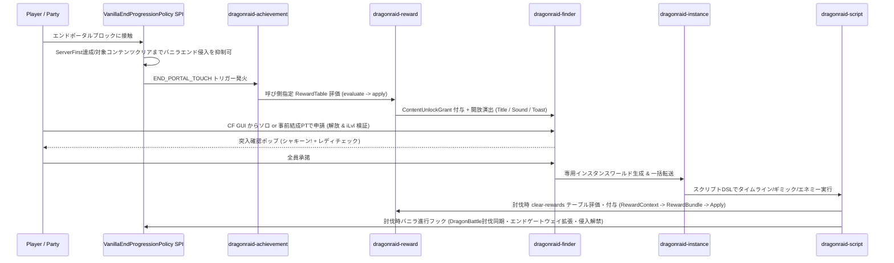

# DragonRaid 企画・要件定義・詳細仕様書（MMO コンテンツプラットフォーム版）

- **プロジェクト名**: DragonRaid
- **ターゲット環境**: Minecraft 26.3 / Paper / Folia
- **開発言語**: Java / Gradle 13 サブモジュール構成（Kotlin Scripting DSL 拡張基盤）
- **必須プラグイン依存**: `packetevents` / `Worlds`（TheNextLvl Worlds） / `BetterModel`
- **モデル表現**: `BetterModel` カスタムモデル（`.bbmodel`＋ボーンアニメーション）とバニラ＋PacketEvents モデルの両方を対等なレンダラーとしてサポート
- **クライアント要件**: クライアント MOD 不要（`VANILLA` レンダラーはリソースパック不要、`BETTER_MODEL` レンダラーでカスタムモデルを使う場合は BetterModel 生成リソースパックを配布・適用）

---

## 1. コンセプトとプラットフォーム設計思想

### 1.1 「MMO レイド＆コンテンツ構築プラットフォーム」としての DragonRaid
DragonRaid は単一の固定ボスイベントプラグインではなく、FF14／WoW スタイルの **インスタンス制 MMO コンテンツ群を構築・運用できる基盤プラットフォーム** である。

- **コアとコンテンツの完全分離**: 13 モジュールから成るプラグイン本体は「パーティ・コンテンツファインダー・一時インスタンス・空間演出・タイムライン/スクリプトDSL・エネミー/モデル・実績/解放・報酬・仮想通貨/ショップ・アイテム/`iLvl`・カスタムステータス」という汎用プラットフォーム基盤のみを提供する。
- **コンテンツパック方式（`plugins/DragonRaid/contents/<pack-id>/`）**: サーバー管理者は、コンテンツパックとして独自のレイド・討滅戦・ダンジョン・カスタム通貨・カスタム装備・解放トリガーを自由に追加・差し替えできる。
- **初期テンプレート兼機能デモ（`default_ender_dragon`）**: エンダードラゴン戦（Normal / Hard）はプラットフォームが標準同梱する「初期テンプレート／デモパック（`plugins/DragonRaid/contents/default_ender_dragon/`）」として初回起動時に自動展開される。不要であれば管理者がフォルダ削除または設定無効化するだけでコア挙動に影響なく完全除去できる。

### 1.2 戦闘・アクション方針：MC戦闘ベース＋ギミック誘導型
- プラットフォーム上で、バニラのアクション戦闘（近接武器・弓・クロスボウ・トライデント・盾・ポーション・エンダーパール・水バケツ・ブロック設置等）と、カスタムステータス／`iLvl`／固有装備スキルを組み合わせたタイムライン＆ギミック攻略を構築できる。
- 固定ロール（Tank / Healer / DPS）を強制せず、ギミックとスクリプト側のターゲット選定で柔軟に役割（強攻撃の盾受け、遠距離破壊、蘇生支援、頭割り参加など）を設計できる（将来的なスクリプト側ロール定義拡張も妨げない SPI 設計）。

---

## 2. 13 モジュール・スター型エコシステム構成

ルート `src/` を廃止し、Paper/Folia プラグイン本体を **`dragonraid-paper`** へ移管したうえで **`dragonraid-api`** を中心とする 13 サブモジュール構成とする。

```mermaid
flowchart TD
    PAPER["dragonraid-paper (Paper/Folia Bootstrap & Shadow JAR)"]
    API["dragonraid-api (Common SPI, Events, Domain Models)"]
    CORE["dragonraid-core (Engine, Telegraphs, Combat State, Protection)"]
    INST["dragonraid-instance (Temporary Arenas via Worlds)"]
    MODEL["dragonraid-model (BetterModel Required & Vanilla Controller)"]
    SCRIPT["dragonraid-script (Kotlin DSL & Content Pack Loader)"]
    PARTY["dragonraid-party (Party, Chat Channels, Sidebar HUD)"]
    FINDER["dragonraid-finder (Content Finder GUI, Ready Check, Gate)"]
    ACH["dragonraid-achievement (Data-Driven Trigger Engine)"]
    REW["dragonraid-reward (Data-Driven Reward & Unlock Dispatcher)"]
    ECON["dragonraid-economy (Multi-Currency Ledger & Shop GUI)"]
    ITEM["dragonraid-item (Custom Gear, iLvl, Skills, Enchants)"]
    STAT["dragonraid-stat (Stat Aggregation, Buffs, Damage Modifiers)"]

    PAPER --> API
    PAPER --> CORE
    PAPER --> INST
    PAPER --> MODEL
    PAPER --> SCRIPT
    PAPER --> PARTY
    PAPER --> FINDER
    PAPER --> ACH
    PAPER --> REW
    PAPER --> ECON
    PAPER --> ITEM
    PAPER --> STAT

    CORE --> API
    INST --> API
    MODEL --> API
    SCRIPT --> API
    PARTY --> API
    FINDER --> API
    ACH --> API
    REW --> API
    ECON --> API
    ITEM --> API
    STAT --> API
```

| モジュール | 責務概要 |
| :--- | :--- |
| `dragonraid-api` | 全モジュールの共通 SPI・ドメインモデル・イベント・`RaidServiceRegistry`・`VanillaEndProgressionPolicy`・各種レジストリ契約 |
| `dragonraid-core` | 汎用エンカウンター状態機械・Folia スケジューラ抽象・ダウン/蘇生/ワイプ制御・サンドボックス保護＆ロールバック・PacketEvents 空間 Display 予兆＆着弾分離エンジン |
| `dragonraid-instance` | `TheNextLvl Worlds` 統合による一時インスタンス生成・フラット円形アリーナ等テンプレート構築・高速ワイプリセット・帰還破棄 |
| `dragonraid-model` | `BetterModel` 必須統合＋バニラ/PacketEvents モデル両対応の `ActorModelService`（ボーン座標・Yaw オフセット・アニメ再生同期） |
| `dragonraid-script` | コンテンツパックローダー（`contents/<pack-id>/`）＆ Kotlin Scripting DSL（タイムライン・カスタムギミック・エネミー生成・バニラ進行スクリプトフック） |
| `dragonraid-party` | パーティ管理（結成・招待・リーダー委譲・キック）、パーティチャット（`/pc`・チャンネル切替）、PacketEvents 右サイドバー FF14 風パーティリスト HUD |
| `dragonraid-finder` | FF14 風コンテンツファインダー GUI、ソロ／事前結成パーティ申請（野良オートマッチングなし）、解放条件＆最低平均 `iLvl` チェック、突入確認（レディチェック／「シャキーン！」）→ インスタンス突入 |
| `dragonraid-achievement` | データドリブン実績・条件トリガーエンジン（`END_PORTAL_TOUCH`、`ENCOUNTER_CLEAR`、`SERVER_FIRST`、`NO_DEATH`、スクリプト条件） |
| `dragonraid-reward` | Loot Table 型純粋報酬評価エンジン＆副作用アプライヤ（`RewardTable` / `RewardContext` → `RewardBundle` → `RewardApplier`、クロス・パック `inject-into` 拡張、解放・仮想通貨・アイテム・スクリプト付与） |
| `dragonraid-economy` | 複数仮想通貨台帳（アラガントームストーン風週獲得上限・所持上限対応・SQLite 永続化）およびデータドリブン交換ショップ GUI 基盤 |
| `dragonraid-item` | カスタム装備・アイテム基盤（アイテムレベル `iLvl`・装備部位・固有アクティブ/パッシブスキル・カスタムエンチャント/レリック・PDC 識別） |
| `dragonraid-stat` | プレイヤー＆エネミーのカスタムステータス／属性集計、時限バフ/デバフスタック、与ダメ/被ダメ/回復補正エンジン |
| `dragonraid-paper` | Paper 26.3 / Folia プラグインエントリポイント、Bukkit リスナー統合、Brigadier コマンド統合、DB アダプタ、単一 Shadow JAR ビルド |

---

## 3. コンテンツパック（Content Pack）とスクリプト設計

### 3.1 コンテンツパックディレクトリ構造
サーバー管理者は `plugins/DragonRaid/contents/<pack-id>/` 配下にコンテンツ一式を配置する。

- `pack.yml`（パック ID・有効/無効フラグ・メタ情報）
- `contents/`（コンテンツファインダーへ登録するコンテンツ定義：表示名、推奨/最大人数、必要 `min-iLvl`、必要アンロックキー、クリア時呼び出し報酬テーブル `clear-rewards`、タイムライン/スクリプト参照、インスタンス設定）
- `enemies/`（データドリブン `RaidEnemyDefinition` 定義）
- `achievements/`（アチーブメントトリガー定義：`END_PORTAL_TOUCH`, `ENCOUNTER_CLEAR`, `SERVER_FIRST` 等、および達成時呼び出し報酬テーブル `rewards`）
- `rewards/`（Loot Table 型純粋報酬テーブル `reward-tables`［`pools` / `rolls` / `conditions` / `functions` / `TABLE_REF`］および他パック既存テーブルへ pool を差し込むクロス・パック拡張 `extensions`［`inject-into`］）
- `items/` & `shops/`（カスタム装備/`iLvl`/ステータス、交換ショップ定義）
- `scripts/`（`.raid.kts` によるカスタムギミック・タイムライン・バニラ進行連携フック）

### 3.2 コンテンツ解放・CF 突入・バニラ進行 SPI フロー
旧来の「初回エンド進入時強制ワープ」および「帰還ポータル祭壇 GUI」を撤廃し、**データドリブン解放 × コンテンツファインダー × バニラ進行 SPI** に一本化する。

- **バニラエンド進行 SPI（`VanillaEndProgressionPolicy` / `VanillaProgressionService`）**:
  - サーバー側スクリプト／コンテンツパック定義から、「誰かが Server First で指定レイドをクリアするまでバニラエンド到達不可」「Normal 討伐時にバニラエンド本島の `DragonBattle` を撃破済み状態に同期し、既存のエンドゲートウェイ／帰還ポータル解放やゲートウェイ拡張を実行する」といった制御をプラグイン本体改修なしに記述できる。
  - パックの初回ロードに失敗した場合、正常な再読み込みが完了するまでバニラエンド進入ゲートは **fail-closed（進入拒否）** 状態を維持する（正常ロードの結果ルールが空である場合とは明確に区別する）。
  - `clear-hooks` の `server-first-only` 実行履歴は配列位置ではなく安定したフック `id`（未指定時は決定論的ダイジェスト）をキーとしてサブステップ単位で永続化され、部分失敗からの再開や順序変更に耐える。既存データベースから移行した旧位置キーについても同一位置の既完了フックを安定キーへ互換移行する。
  - **遭遇別初回クリア履歴（`player_encounter_clears`）**: SQLite 初期化マイグレーション `m2_migrate_legacy_encounter_clears_v1` により、既存の `player_stats`（`normal_clears > 0` / `hard_clears > 0`）をそれぞれ `dragon_normal` / `dragon_hard` として `player_encounter_clears` へ 1 回限り冪等移行する。新規に追加したコンテンツパック固有の遭遇 ID に対する `FIRST_CLEAR` 判定は、M2 導入（`player_encounter_clears` 有効化）以降の討伐から個別に記録される。
  - **名前空間付き ID とコマンド補完**: コンテンツ／実績／報酬テーブル／通貨の各 ID には `:` を含む名前空間形式を許容し、コマンド上では Brigadier 引用符文字列引数と自動エスケープタブ補完（`StringArgumentType.escapeIfRequired`）で選択・実行できる。

---

## 4. パーティ・コンテンツファインダー・戦闘 UX 仕様

### 4.1 パーティシステム（`dragonraid-party`）
- **パーティ管理**: 作成・招待（承諾/辞退）・離脱・キック・リーダー委譲・解散。一時的な回線切断時は一定時間メンバー席・再合流権を保持。
- **パーティチャット**: `/pc <message>` による単発送信および `/p chat` でのチャットチャンネル切替（Party / Global）に対応。
- **FF14 風パーティリスト HUD**: PacketEvents（または個人別 Scoreboard スコアパケット）を用いて画面右サイドバーにリアルタイム描画。各メンバーの名前・リーダー記号・現在 HP/最大 HP バー・`ALIVE`/`DOWNED`/`DEAD_SPECTATOR` 状態・蘇生回数・盾ガード中アイコンなどを表示。

### 4.2 コンテンツファインダー（`dragonraid-finder`）
- **申請単位**: 野良プレイヤー同士の自動マッチングは行わず、**ソロ（$N=1$）** または **事前結成パーティ** 単位で即時申請する。
- **参加ゲート**: データドリブンで定義された「コンテンツ解放済みフラグ（パーティ全員またはリーダー要件設定可）」および「最低平均 `iLvl`」を申請時にチェック。
- **突入確認（レディチェック）**: 申請条件を満たすとパーティ全員へ FF14 風突入確認（効果音「シャキーン！」＋カウントダウン付き承諾/辞退 GUI・コマンド）を表示。全員が承諾した時点で専用インスタンスを生成し一括転送する。

### 4.3 戦闘状態遷移・サンドボックス・空間 Display 予兆仕様
1. **ダウン＆蘇生（`ALIVE` / `DOWNED` / `DEAD_SPECTATOR`）**:
   - 戦闘中の致死ダメージ・奈落落下（設定高度未満）は死亡をキャンセルし `DOWNED` へ遷移（魂マーカー表示）。味方による一定時間のスニーク長押し等で蘇生。上限回数・時間切れ時は `DEAD_SPECTATOR` へ遷移。
   - 全生存者 0 人でワイプ（`WIPE`）となり、同一インスタンスのままボス・クリスタル・一時ブロックを即座にリセットして再挑戦。
2. **サンドボックス保護＆ロールバック**:
   - レイド中のアイテムロスト保護（設定可）、ベッド／アンカー爆破抑止、アリーナ基底ブロックの破壊禁止、プレイヤー／ギミック設置ブロックの自動ロールバック。
3. **FF14 風・床発光 Display 予兆と着弾演出の厳格分離**:
   - **予兆中（パーティクル完全不使用）**: PacketEvents のフルブライト `BLOCK_DISPLAY`（透過ステンドグラス＋キャスト進捗拡大チャージ＋コンクリート/シーランタン枠線）＋ `TEXT_DISPLAY` により、床ブロック上面（`DEFAULT_SURFACE_Y` 等、非インスタンス時は `RegionScheduler` 上で固体上面 `y + 1.0` を解決）へ描画。
   - **頭割り専用マーカー**: 床面ベタ塗りを廃止し、細い中抜き外周リング＋中心へ脈動収束する 4 方向 3D ブロック矢印＋頭上大型下向き 3D 矢印（ソロ時は集合矢印なしの防御推奨リングへ自動切替）。
   - **着弾時（インパクトのみパーティクル）**: 判定解決タイミングで予兆 Display キーを即時消去した上で、`ImpactBurst` / `LaserBeam` / `LightningStrike` のパーティクル演出を発火。

---

## 5. 装備・`iLvl`・カスタムステータス・経済基盤（M5）

- **`dragonraid-economy`**: コンテンツごと・難易度ごとの複数仮想通貨（トークン、週上限付き高位トークン等）の付与・消費履歴・交換ショップ GUI。
- **`dragonraid-item`**: カスタム武器・防具・レリックの定義、アイテムレベル `iLvl` 算出、固有アクティブスキル／パッシブ効果、特殊エンチャント、リメイク保護。
- **`dragonraid-stat`**: 装備・バフ・デバフ・環境補正からプレイヤー／エネミーの実効ステータス（最大 HP 補正、攻撃力、軽減率、特定エネミー特効等）を集計・適用する汎用計算基盤。

---

## 6. 初期テンプレート『`default_ender_dragon`』コンテンツパック（M6）

プラットフォーム全 13 モジュール完成後、M6 にて初期テンプレート兼総合機能デモとして `contents/default_ender_dragon/` を同梱実装する。

- **概要**: 本来のエンドポータル接触 → アチーブメント/リワードによる「終焉の龍（Normal）」解放 → コンテンツファインダー申請 → 専用円形 Void アリーナ（半径 40m、高さ 8m の低黒曜石柱 8 本）へ突入 → 初回討伐時のバニラエンド `DragonBattle` 撃破同期・エンドゲートウェイ拡張＆ Hard 解放。
- **収録要素**:
  - **Normal（3 フェーズ）/ Hard・Savage（4 フェーズ）**: `DRAGON_DIVE_STACK`, `GROUND_SLAM_DIVE`, `LIGHTNING_STORM`, `SWEEPING_LASER`, `SHIELD_WALL_BREATH`, `FIREBALL_BARRAGE`（可視 3D 火球＋2.2 秒床予兆）, `ENDERMAN_ERUPTION`, `EXAFLARE_WAVES`, `KNOCKBACK_COMBO`, `ENDERMAN_ROTATING_BEAM`, `DUAL_DIVE_DICE`, `TETHER_DIVE_RELAY`, 1 発破壊クリスタル＋落雷/追尾ビーム防衛。
  - **デモ通貨・ショップ・装備（`iLvl`／ステータス付き）**: 竜鱗の盾・虚空翼エリトラ・竜殺し武器・奈落の護符等。

---

## 7. マイルストーン全体工程（M1〜M6）

| マイルストーン | フェーズ位置付け | 主なゴール |
| :--- | :--- | :--- |
| **M1** | 構造再編・白紙化 | ルート `src/` の `dragonraid-paper` 移管、13 モジュール体制構築、旧突入導線＆旧ドラゴン固有実装の撤去 |
| **M2** | コンテンツ解放・バニラSPI | `contents/<pack-id>/` ローダー、データ駆動アチーブメント＆リワード解放、`VanillaEndProgressionPolicy` SPI |
| **M3** | パーティ＆コンテンツファインダー | `dragonraid-party`（PT・`/pc`・サイドバーHUD）＋ `dragonraid-finder`（申請GUI・解放/iLvlゲート・シャキーン/レディチェック・突入） |
| **M4** | エネミー・モデル・スクリプトDSL | データ駆動エネミー、BetterModel必須/バニラ両対応、Display予兆/着弾基盤、KotlinスクリプトDSL |
| **M5** | ステータス・装備/iLvl・経済 | `dragonraid-stat`、`dragonraid-item`、`dragonraid-economy` のプラットフォーム基盤完成 |
| **M6** | デフォルトパック＆リリース検証 | 削除可能な初期テンプレート『`default_ender_dragon`』パック実装、Folia 負荷・E2E 検証、管理者ドキュメント完成 |

---

## 8. Folia マルチスレッド設計要件
- ワールド上のブロック操作・エンティティスポーン/移動・プレイヤー状態変更・地形スキャンは、必ず対象座標の `RegionScheduler` または対象エンティティの `EntityScheduler` 上で実行する。
- スクリプト／ギミック側は `RaidScriptContext` 経由の読み取り専用スナップショットとスケジュール済みアクション呼び出しに限定し、Folia リージョン境界違反を構造的に防止する。
- 予兆やパーティリスト HUD 等はサーバー側エンティティを濫用せず PacketEvents パケットベースで描画し、Folia リージョンスレッド負荷を最小化する。
